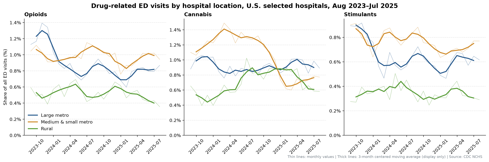

> **요약 (Korean summary)**
> 미국 CDC 표본 병원의 약물 관련 응급실 방문 자료(2023.08~2025.07)를 병원 소재지(대도시·중소도시·농촌)별로 분석했습니다.
> - 오피오이드 관련 방문은 첫해 대비 11% 감소했고, 감소는 대도시권(−18%)에 집중되었습니다.
> - 오피오이드와 대마초 사이의 대체 관계, 도시–농촌 간 ‘풍선 효과’는 통계적으로 확인되지 않았습니다.
> - 1차 분석의 오류(이동평균으로 부풀려진 상관계수, 정책 시행 이전 자료 부재)를 바로잡고, 바뀐 점을 아래 [What changed from v1]에 정리했습니다.

# Drug-Related ED Visits in U.S. Hospitals by Urban–Rural Location, 2023–2025

Monthly opioid-, cannabis- and stimulant-related emergency department (ED) visits in a CDC sample of U.S. hospitals, compared across large metro, medium/small metro and rural hospitals.

This is version 2. Version 1 claimed a policy effect, a substitution effect and a "balloon effect" between regions. When I re-checked it, none of those claims held up. See [What changed from v1](#what-changed-from-v1).

## Questions

1. Did opioid- and cannabis-related ED visit rates change between the first and second year of the data?
2. Do opioid and cannabis visits move in opposite directions, as they would if users switched from one to the other?
3. Do large metro and rural hospitals move in opposite directions?

## Data

| Item | Details |
|---|---|
| Source | CDC, National Center for Health Statistics — [Drug Use Data from Selected Hospitals](https://catalog.data.gov/dataset/drug-use-data-from-selected-hospitals) |
| Survey | National Hospital Care Survey (NHCS) |
| Period | Aug 2023 – Jul 2025 (24 months) |
| Measure | Percent of **all** ED visits in that month with the drug-related diagnosis |
| Urban–rural | By **hospital location** (NCHS county classification), not patient residence |

**Caveats from the source:** the data are preliminary and **not nationally representative**. They come from a limited set of participating hospitals, count visits rather than patients, and use only the first ten diagnosis codes. ([CDC](https://www.cdc.gov/nchs/dhcs/drug-use/drug-use-urban-rural.htm))

## Method

- **Trend:** average of the first 12 months vs the last 12 months, plus a linear slope. The slope's p-value is optimistic, because consecutive months are not independent.
- **Correlation:** Pearson correlation on the raw monthly rates **and** on month-over-month differences.
  - Two series that both decline will correlate on raw values even if they are unrelated from month to month. The differenced correlation removes the shared trend and asks: when one goes up this month, does the other go down?
- **Smoothing:** a 3-month moving average is drawn on the chart **for display only**. No statistic uses smoothed data.

## Results



### 1. Opioid visits fell, mostly in large metro hospitals

| Group | First 12 months | Last 12 months | Change | Slope p |
|---|---|---|---|---|
| Opioids, all hospitals | 0.96% | 0.85% | −11% | 0.001 |
| Opioids, large metro | 0.98% | 0.80% | −18% | 0.001 |
| Opioids, medium/small metro | 1.01% | 0.96% | −5% | 0.30 |
| Opioids, rural | 0.54% | 0.50% | −7% | 0.13 |

Stimulant visits also fell by about 11% overall, so the decline is not specific to opioids.

### 2. No sign of opioid–cannabis substitution

| Comparison | r (raw) | p | r (differenced) | p |
|---|---|---|---|---|
| Opioids vs cannabis, all hospitals | +0.52 | 0.009 | +0.33 | 0.12 |

Cannabis visits also fell overall (1.05% → 0.88%, −17%). The raw correlation is **positive** because both declined together. Substitution would show up as a negative correlation, and there is none, raw or differenced.

### 3. No reliable urban–rural seesaw

| Comparison | r (raw) | p | r (differenced) | p |
|---|---|---|---|---|
| Opioids: large metro vs rural | −0.15 | 0.48 | −0.06 | 0.79 |
| Cannabis: large metro vs rural | −0.33 | 0.11 | −0.33 | 0.13 |

Both correlations are negative but not statistically distinguishable from zero with 24 months of data.

### Sudden level shifts

Some series jump between levels instead of drifting. Rural cannabis visits rose from about 0.5% to 0.85–0.9% in mid-2024, then dropped back to about 0.6% in April 2025. Medium/small metro cannabis fell from 1.2% to 0.65% between December 2024 and February 2025. Because the sample has a limited number of hospitals, shifts like these may reflect hospitals joining or leaving the sample rather than real changes in drug use. The public data do not show the hospital composition, so this cannot be checked.

## Limitations

- **Not nationally representative**, and the hospital sample may change over time.
- **24 months** gives low statistical power. "Not significant" here means "not detectable with this data", not "no effect".
- **No pre-2023 data**, so no before/after comparison with any policy is possible.
- **Several tests at once:** with 12 trend tests, one p-value around 0.03 could appear by chance.
- ED visits measure acute cases at hospitals, not overall drug use.

## What changed from v1

| v1 claim | What I found when re-checking | v2 |
|---|---|---|
| Assessed an opioid policy from early 2023 | The data start in August 2023, so there is no pre-policy period | Policy framing removed |
| Smoothing "enhanced statistical validity" | A moving average makes neighbouring months share data and inflates correlation | Smoothing only on the chart; statistics on raw and differenced data |
| Negative urban–rural correlation confirmed | r = −0.15, p = 0.48 for opioids | Reported with p-values; not significant |
| Balloon effect between regions | A correlation cannot show people or supply moving between places | Removed |
| Regulation worked in rural areas, cities rebounded | Not tested; rural cannabis rose and fell in steps that may come from sample changes | Removed; level shifts reported as a caveat |
| Chart labelled "Smoothed" showed raw opioid values | Label did not match the plotted data | Raw and smoothed lines drawn and labelled separately |

## How to run

```bash
pip install -r requirements.txt
python src/ed_drug_trends.py
```

Outputs are saved to `output/`: `ed_drug_trends.png`, `trend_summary.csv` (all trend numbers above) and `correlations.csv`.

## Project structure

```
USA_opioid/
├── data/        raw CSV from CDC
├── src/         ed_drug_trends.py
├── output/      chart and result tables
├── requirements.txt
└── README.md
```

## Tools

Python · pandas · matplotlib · scipy